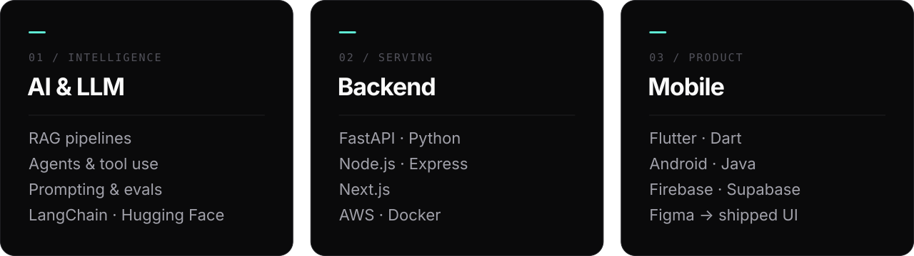

<picture>
  <source media="(prefers-color-scheme: dark)" srcset="./assets/banner-dark.svg" />
  <source media="(prefers-color-scheme: light)" srcset="./assets/banner-light.svg" />
  
</picture>

&nbsp;

I build <b>AI products end to end</b> — LLM pipelines at the core, <b>FastAPI</b> services in the middle, and <b>mobile apps</b> people actually use on top.

&nbsp;

<picture>
  <source media="(prefers-color-scheme: dark)" srcset="./assets/stack-dark.svg" />
  <source media="(prefers-color-scheme: light)" srcset="./assets/stack-light.svg" />
  
</picture>

&nbsp;

  

&nbsp;

<picture>
  <source media="(prefers-color-scheme: dark)" srcset="https://streak-stats.demolab.com?user=OPTRONIX-10&hide_border=true&background=00000000&ring=5EEAD4&fire=5EEAD4&currStreakNum=FAFAFA&currStreakLabel=5EEAD4&sideNums=FAFAFA&sideLabels=A1A1AA&dates=52525B&stroke=27272A" />
  
</picture>

&nbsp;

  <a href="https://linkedin.com/in/ksabhishek">LinkedIn</a>
  &nbsp;&nbsp;·&nbsp;&nbsp;
  <a href="https://instagram.com/k_s_10__">Instagram</a>
  &nbsp;&nbsp;·&nbsp;&nbsp;
  <a href="mailto:ksabhishek00@gmail.com">ksabhishek00@gmail.com</a>

